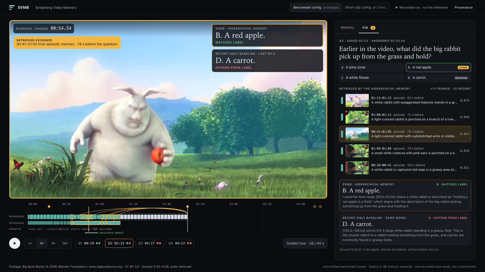
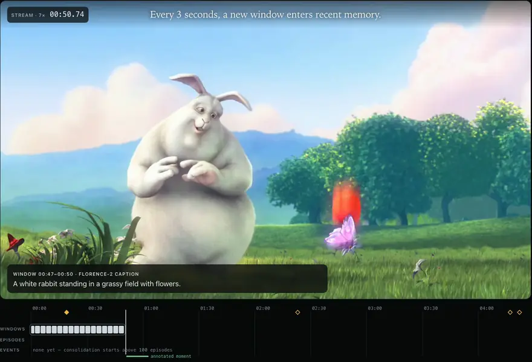
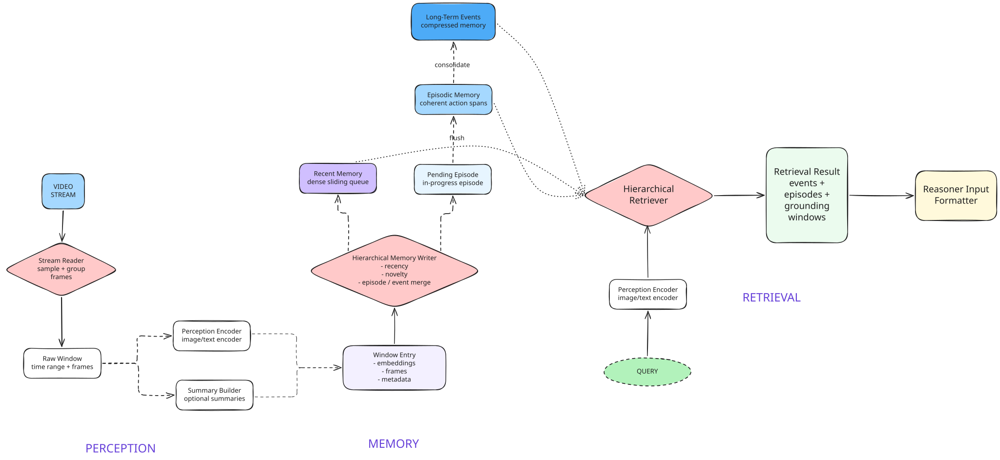

# Streaming Video Memory Buffer

A hierarchical memory system for long-form video understanding. As frames stream in, it keeps the last minute in full, promotes novel moments into episodes and consolidates old episodes into long-term events; a question retrieves evidence from all three tiers instead of re-reading the stream.

[](https://github.com/tolyaho/StreamingVideoMemoryBuffer/actions/workflows/ci.yml)

<p align="center"><a href="https://github.com/tolyaho/StreamingVideoMemoryBuffer/releases/download/showcase-v1/svmb-showcase.mp4"></a></p>

<p align="center"><b><a href="https://github.com/tolyaho/StreamingVideoMemoryBuffer/releases/download/showcase-v1/svmb-showcase.mp4">▶ Watch the 43-second showcase (MP4)</a></b> · <a href="https://github.com/tolyaho/StreamingVideoMemoryBuffer/releases/tag/showcase-v1">Release notes</a> · <a href="#replay-the-showcase-locally">Replay it locally</a></p>

## The problem

A model watching a stream cannot keep every frame in context. A recent-frame buffer is cheap and a strong baseline, but forgets everything that scrolled out. SVMB asks whether a memory written **without knowing future questions** can keep older moments retrievable for a small model.

## Showcase: one recorded run

<p align="center"></p>

The video replays one run of this pipeline, with the unchanged benchmark settings and the Qwen2.5-3B text reasoner, on a 266-second excerpt of *Big Buck Bunny*. Everything shown was recorded during the run: frames and captions, keep/discard decisions, episodes, returned nodes and scores, and both answers verbatim. Playback speed and the jump back in time are presentation, not inference time.

- At **00:51–01:03** the rabbit picks up a red apple. At **02:23** the question is *"Earlier in the video, what did the big rabbit pick up from the grass and hold?"*
- The apple has left the 60-second recent window, but its windows were kept in an **episode** (00:41–01:05). No long-term event existed yet in this run.
- The retriever returned that episode; its Moondream2 text, describing the rabbit holding a red apple, reaches the reasoner.
- **SVMB: "B. A red apple."** Recent-only baseline: **"D. A carrot."**

This is one qualitative example of episodic retrieval, not a measurement.
- On the clip's four questions, frozen before inference, hierarchical memory gets 2 and the baseline 1.
- Both miss a butterfly question 2.5 minutes back, where time decay favoured newer episodes, and a "holding now" question, where the captioner described the bow as a stick or rope.
- A demo-only configuration that forces long-term consolidation scores 1/4 each; its event summary drops the apple.
- The apple question was picked for the video after the results were known, as the [run plan](demo/showcase/RUN_PLAN.md) records.

## How it works

<p align="center"></p>

1. **Windows:** 1 frame/s grouped into 3-second windows, embedded with X-CLIP and captioned with Florence-2.
2. **Recent:** the last 20 windows. An evicted window is kept only if novel (cosine similarity below 0.95 to the rest).
3. **Episodic:** kept windows that are close in time and similar form an episode, with a self-centrality embedding, representative windows and a Moondream2 description.
4. **Long-term:** above `episodic_capacity` episodes, the oldest similar run becomes an event with a Qwen2.5-VL summary.
5. **Retrieval:** recent windows, then events, then episodes inside them plus the newest, grounded to representative windows; score `(0.7·visual + 0.3·text) × time decay`.

The write path never sees question content; a question's arrival only closes the episode being formed. The recent tier is bounded, but episodes, events and the window archive grow with the stream. Details are in [`docs/architecture.md`](docs/architecture.md).

## Results

StreamingBench Real-Time Visual Understanding: the same 250 multiple-choice questions over 50 videos in every run, answered at their timestamps by both systems with the same captioners and reasoner.

| Configuration | Reasoner | Hierarchical | Recent baseline | Δ |
| --- | --- | ---: | ---: | ---: |
| Text / notebook | Qwen2.5-3B-Instruct | 128/250 | 109/250 | +7.6 pp |
| Text / tuned | Qwen2.5-3B-Instruct | 129/250 | 112/250 | +6.8 pp |
| Early VLM | Qwen3-VL-8B-Instruct | 198/250 | 200/250 | −0.8 pp |

- In the notebook run both systems keep 20 recent windows and retrieve top-5, but total memory is **not** equal: hierarchical memory also stores episodes, events, archived windows and summaries. The tuned run gives it a larger recent buffer.
- 46 questions are right only with hierarchical memory and 27 only with the baseline (exact McNemar p ≈ 0.034, question-level; questions within a video are not independent).
- With a VLM reasoner that sees the retrieved frames, there is no gain.

Per-type results, settings and worked examples are in [`results/RESULTS.md`](results/RESULTS.md).

## Quickstart

```bash
git clone https://github.com/tolyaho/StreamingVideoMemoryBuffer && cd StreamingVideoMemoryBuffer
python -m pip install numpy Pillow          # enough for the tests; no models, no videos
python -m unittest discover -s tests
python scripts/paired_stats.py              # recomputes the table above from committed per-question outputs
```

### Replay the showcase locally

```bash
python3 demo/fetch_showcase_media.py        # 43 MB CC BY clip from the GitHub Release, SHA-256 verified
python3 demo/server.py --showcase           # http://127.0.0.1:8765 (Python standard library only)
```

The viewer replays the recorded runs in [`demo/showcase/`](demo/showcase/README.md) offline; it does not run models or process new video.

### Full model runs

These need `python -m pip install -e ".[dev]"` (PyTorch, Transformers), several GB of model weights, the benchmark videos (`scripts/download_video_sample.py`) and a GPU or Apple-silicon machine; see [`docs/experiments.md`](docs/experiments.md) and [`results/RESULTS.md`](results/RESULTS.md#reproduce).

## Documentation

[Architecture](docs/architecture.md) · [Experiments](docs/experiments.md) · [Results](results/RESULTS.md) · [Demo and trace capture](demo/README.md) · [Original walkthrough notebook](notebooks/solution.ipynb)

## License and attribution

- **Code:** MIT ([`LICENSE`](LICENSE)).
- **Showcase footage:** [*Big Buck Bunny*](https://peach.blender.org/) © 2008 Blender Foundation / www.bigbuckbunny.org, [CC BY 3.0](https://creativecommons.org/licenses/by/3.0/). The video, clip, poster, preview and trace thumbnails use an **edited excerpt** (film 0:33–4:59, audio removed, re-encoded). Not endorsed by the Blender Foundation.
- **Models** are downloaded at runtime under their own licences and are not redistributed.
- **Benchmark questions** in `data/` and `results/` come from [StreamingBench](https://github.com/THUNLP-MT/StreamingBench) and [LVBench](https://github.com/THUDM/LVBench); their videos are not included.
